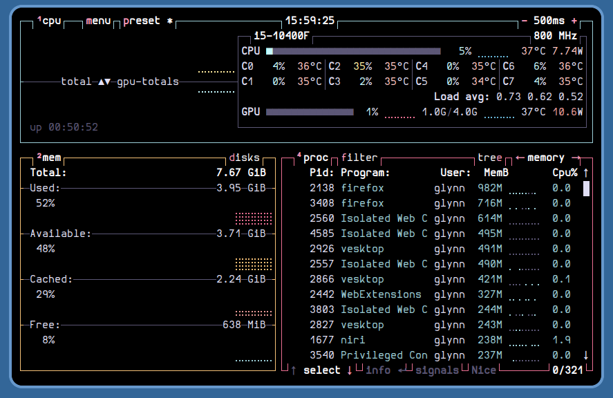
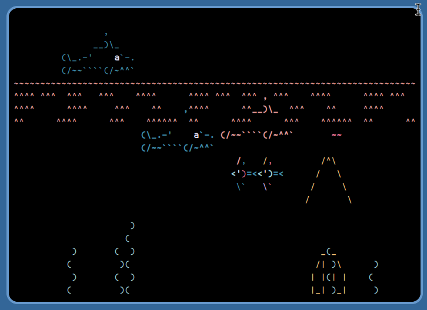
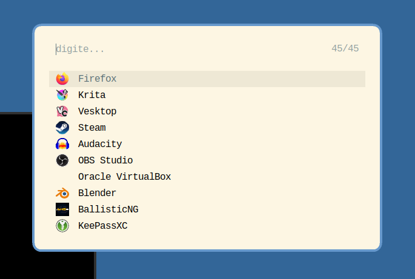
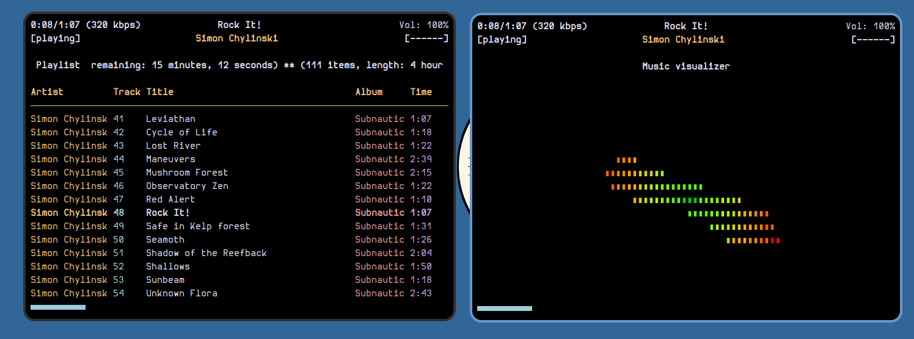
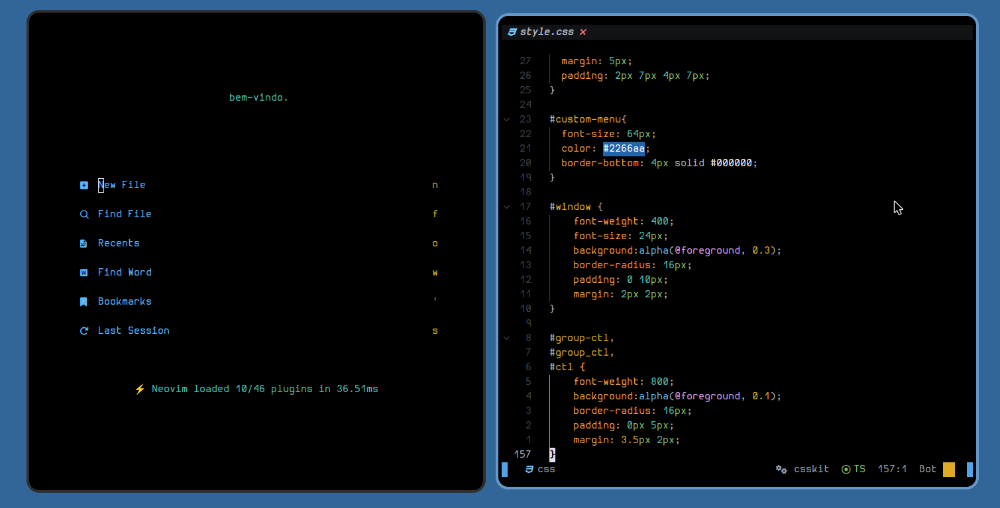
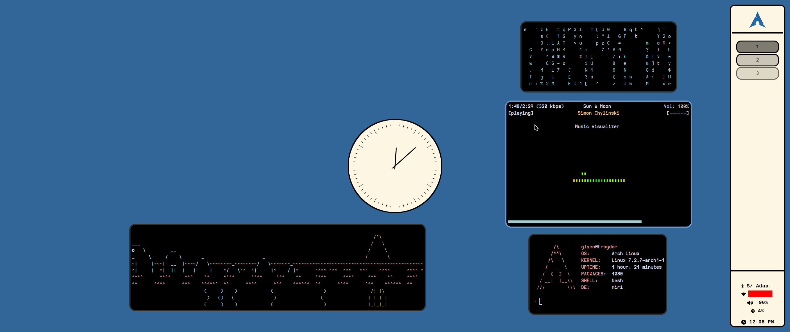
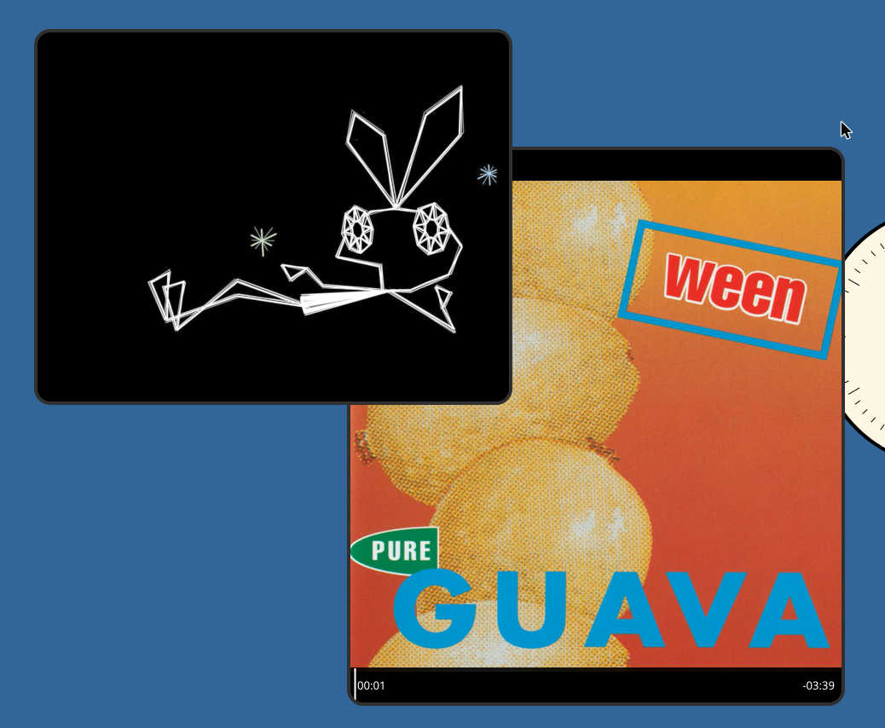
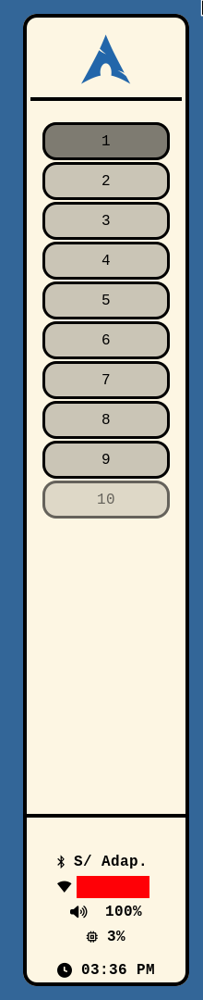

# dotfiles

These are my current **dotfiles** for:
* btop;
* foot;
* fuzzel;
* ncmpcpp;
* niri;
* nvim;
* mako;
* mpv;
* waybar, and;
* yazi.

Also comes with `.config/mimeapps.list` and an install script for the sake of convenience.

# Screenshots

# Depedencies
* wlroots 0.20+
* wayland
* xdg-desktop-portal-wlr
* mako
* fuzzel
* foot
* niri
* yazi
* swaylock
* xwayland-satellite
* waybar
* nmtui
* swaybg
* swayidle
* wlclock
* bluetui

# Changelog
- 10/16/26: Initial commit.

# Credits
* Cursor theme: [Haiku](https://www.gnome-look.org/p/2377122) by GERRY on Gnome-look.org.
* MPV theme: [uosc](https://github.com/tomasklaen/uosc) by tomasklaen.
* Original Waybar theme: [Minimal-waybar-themes (V2.4)](https://github.com/atif-1402/minimal-waybar-themes/tree/main/waybar/V2.4) by atif-1402.
